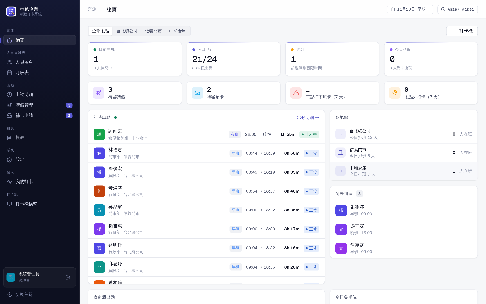
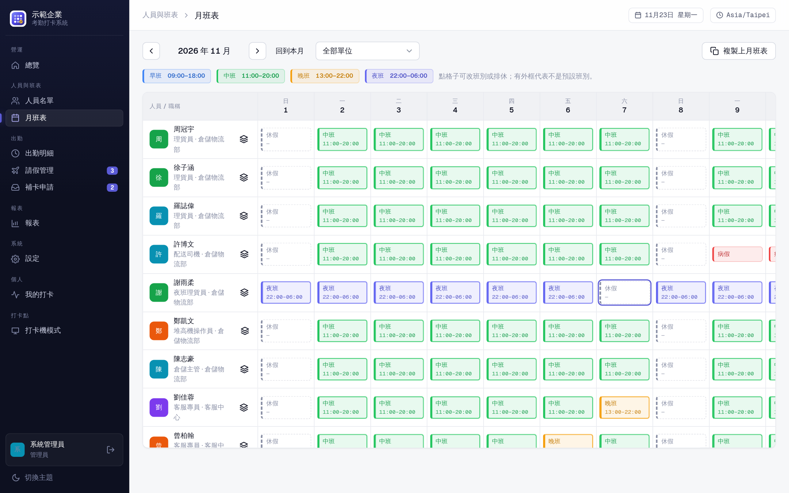
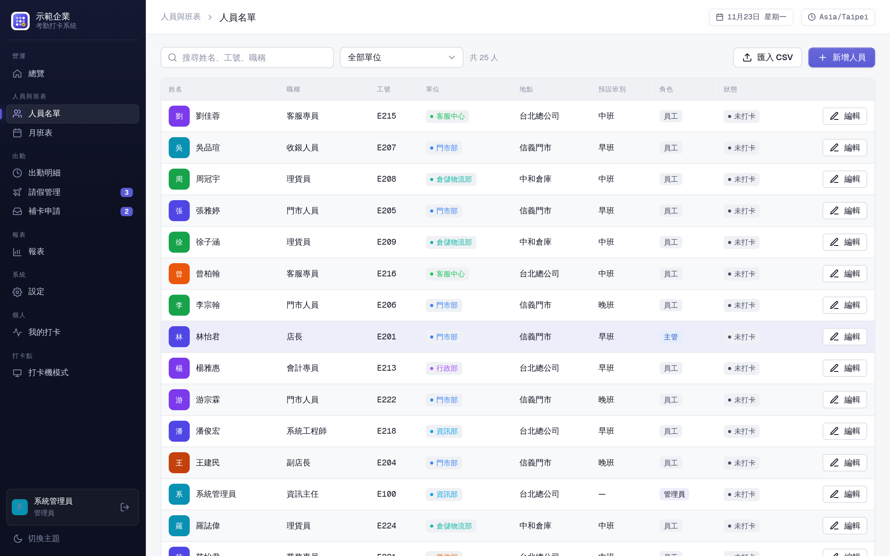
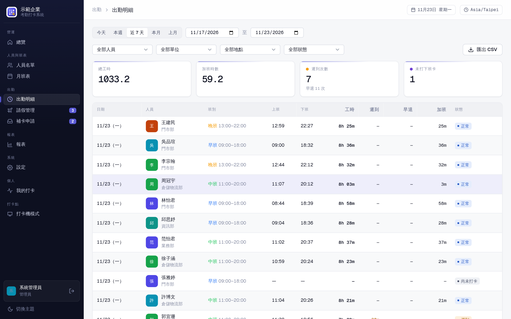
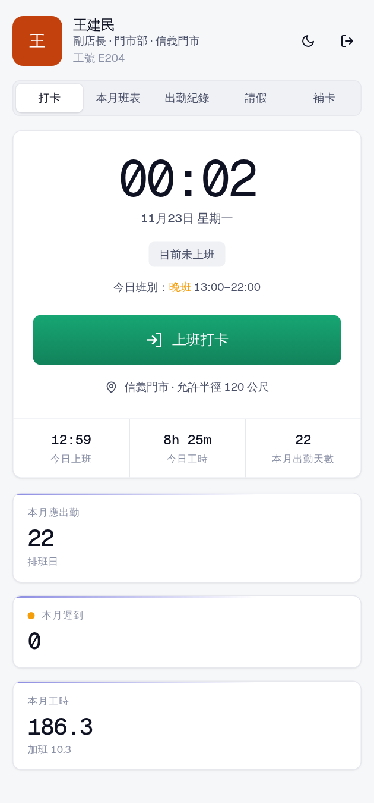
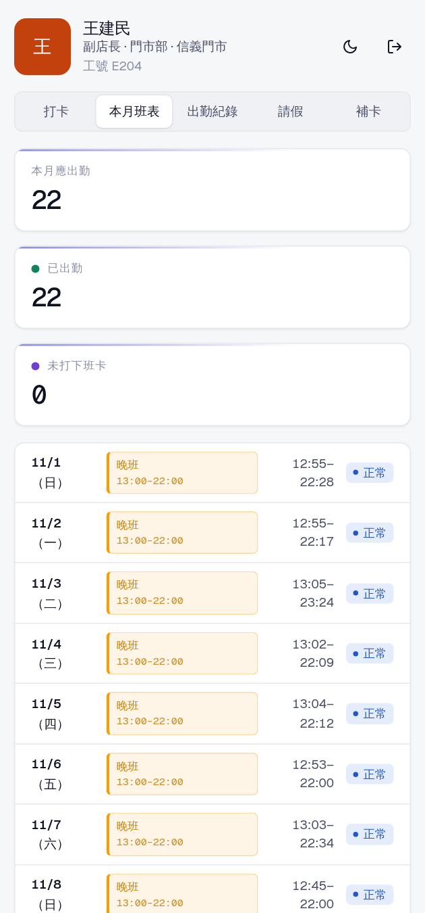
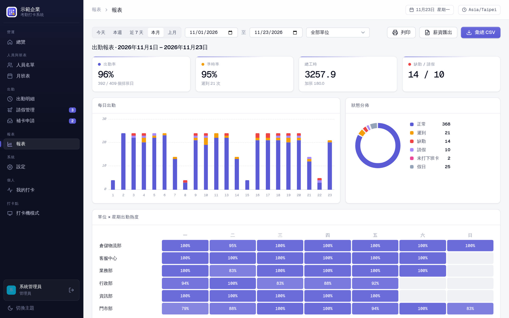
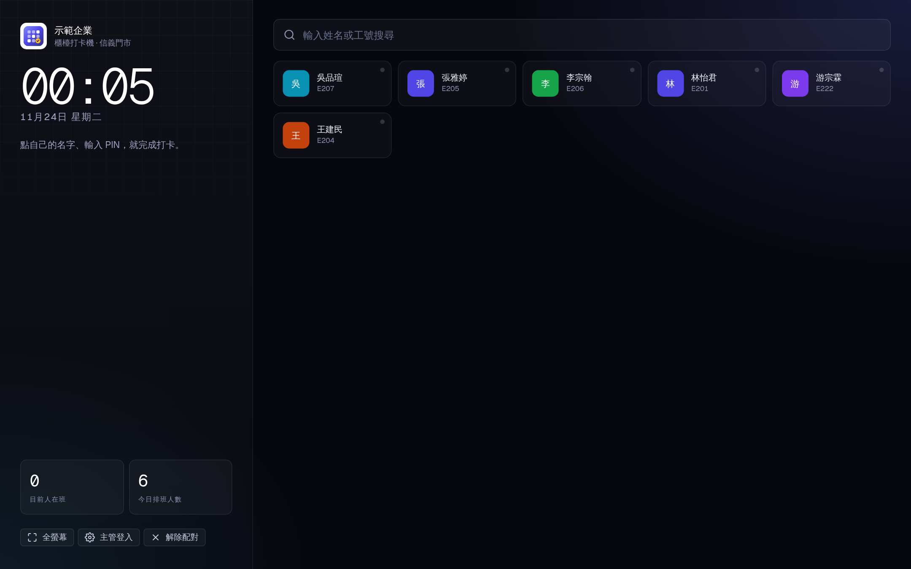

# 考勤打卡系統（繁中版）

一套可以自己架設的**排班＋打卡＋出勤**系統。後台建立人員名單（姓名、職稱、單位）、排整個月的班表；員工用手機或現場打卡機打卡，看自己的月班表和出勤紀錄。

基於開源專案 [rostermark](https://github.com/MusaBukhari237/rostermark)（MIT 授權）修改：介面全面繁體中文化、班表改為整月檢視、示範資料改為台灣情境。原始授權與出處見 [LICENSE](LICENSE) 與本文最後一節。

- 技術：Node.js 22（`node:sqlite` 內建資料庫）、零外部依賴、單一 SQLite 檔案
- 部署：一台 1 核 1GB 的主機就夠；也提供 Dockerfile / docker-compose
- 資料：全部留在自己的機器上（`data/` 目錄），不依賴任何雲端服務

---

## 畫面

| 後台總覽 | 月班表 |
| --- | --- |
|  |  |

| 人員名單（含職稱、單位） | 出勤明細 |
| --- | --- |
|  |  |

| 員工端打卡（手機） | 員工端本月班表 |
| --- | --- |
|  |  |

| 報表 | 現場打卡機 |
| --- | --- |
|  |  |

---

## 功能

### 前台（員工端，手機優先）
- **打卡**：上班／下班／開始休息／結束休息，一個大按鈕完成；顯示今日班別與時間
- **本月班表**：整月每一天列出「幾點上班－幾點下班」、班別名稱、當天實際打卡與狀態（正常／遲到／請假／休假）
- **本月統計**：應出勤天數、已出勤、遲到次數、未打下班卡、工時與加班
- **出勤紀錄**：近 14 天的打卡與工時
- **請假**：選假別、日期（可半天）、事由送出，看審核狀態與剩餘額度
- **補卡**：忘記打卡時提出補登申請，主管核准後自動寫入出勤

### 後台（管理員／主管）
- **總覽**：目前在班、今日已到／應到、遲到、請假、待審批事項、地點人數、即時出勤與最近打卡
- **人員名單**：姓名、工號、**職稱**、**單位**、地點、預設班別、角色、在職狀態；可上傳照片、CSV 匯入
- **月班表**：整月一頁，每人每天一格；點格子改班別／排休、套用到整月、**一鍵複製上月班表**；下方顯示每日各班別人數
- **出勤明細**：區間查詢、依人員／單位／地點／狀態篩選，遲到、早退、加班、未打下班卡、地點外打卡；點任一筆可看當天所有打卡並補登／修改／刪除
- **請假管理／補卡申請**：核准或駁回，全程寫入稽核紀錄
- **報表**：出勤率、準時率、每日出勤堆疊圖、狀態分佈、單位×星期熱度、個人統計；可列印、匯出 CSV（彙總／薪資／明細，表頭為中文）
- **設定**：公司名稱、時區、跨日切換時間、加班門檻、是否強制地點、是否拍照、品牌標誌與主色
- **地點與圍籬**：地址、經緯度、允許半徑（公尺），可用「目前位置」一鍵填入
- **單位／班別／假別／假日**：班別含上下班時間、休息分鐘、遲到寬限、出勤日（支援跨夜班 22:00–06:00）
- **打卡機**：每一台裝置一組金鑰，可單獨撤銷，顯示最後連線時間
- **API 與 Webhook**：唯讀／讀寫金鑰、HMAC 簽章推送
- **稽核紀錄**：誰改了什麼

---

## 角色與示範帳號

以 `DEMO=1` 啟動時會自動建立示範資料（25 人、6 單位、3 地點、4 班別、整月班表與近 35 天打卡）。密碼統一 `demo1234`，PIN 統一 `1234`。

| 角色 | 登入方式 | 帳號 |
| --- | --- | --- |
| 管理員 | 電子郵件＋密碼 | `admin@demo.local` / `demo1234` |
| 主管 | 電子郵件＋密碼 | `manager@demo.local` / `demo1234` |
| 員工 | 工號＋PIN | `E204` / `1234`（王建民，副店長） |

> 登入頁有「管理員／主管／員工」三個快速按鈕，按下去會自動填好帳密。

正式上線請**不要**設 `DEMO=1`，改用 `ADMIN_EMAIL` / `ADMIN_PASSWORD` 建立第一位管理員（只在空資料庫時生效），登入後再從「人員名單」建立其他人。

---

## 本機啟動

需求：Node.js **22.13 以上**（用到內建的 `node:sqlite`，不需要安裝 MySQL／Postgres）。

```bash
cd attendance-system
DEMO=1 PORT=3001 npm start
# 開啟 http://localhost:3001        ← 後台／員工端
# 開啟 http://localhost:3001/kiosk  ← 現場打卡機
```

第一次啟動會在 `data/rostermark.db` 建庫；要重置示範資料，把整個 `data/` 刪掉再啟動即可。

環境變數：

| 變數 | 預設 | 說明 |
| --- | --- | --- |
| `PORT` | `3000` | 服務埠 |
| `DATA_DIR` | `./data` | SQLite 與 session 密鑰存放位置（備份這個目錄就好） |
| `DEMO` | 關閉 | `1` 時空庫會灌示範資料，並在登入頁顯示示範帳號 |
| `DEMO_RESET_HOURS` | `0` | 大於 0 時，每隔 N 小時重置示範資料 |
| `ADMIN_EMAIL` / `ADMIN_PASSWORD` | 無 | 空庫時建立的第一位管理員 |
| `APP_NAME` | 品牌設定 | 顯示名稱，預設「考勤打卡系統」 |
| `SESSION_SECRET` | 自動產生 | 建議正式環境明確設定 |

---

## 部署到主機

程式本身只需要 Node 22 與一個可寫的資料目錄，所以「先放雲、之後搬到自己主機」很容易：**同一份程式碼、同一個資料夾**搬過去就行。

### 方式 A：直接跑 Node（最簡單，適合 VPS）
```bash
# 主機上（Ubuntu 為例）
curl -fsSL https://deb.nodesource.com/setup_22.x | sudo -E bash -
sudo apt install -y nodejs
sudo mkdir -p /srv/attendance && sudo chown $USER /srv/attendance
# 把專案複製到 /srv/attendance（git clone 或 scp 上傳）
cd /srv/attendance
ADMIN_EMAIL=you@company.com ADMIN_PASSWORD='換成你的密碼' PORT=3000 npm start
```
長期執行用 systemd（`/etc/systemd/system/attendance.service`）：
```ini
[Unit]
Description=Attendance
After=network.target

[Service]
WorkingDirectory=/srv/attendance
Environment=PORT=3000
Environment=DATA_DIR=/srv/attendance/data
Environment=ADMIN_EMAIL=you@company.com
Environment=ADMIN_PASSWORD=change-me
ExecStart=/usr/bin/npm start
Restart=always
User=www-data

[Install]
WantedBy=multi-user.target
```
前面再接 nginx 做 HTTPS（打卡需要相機與定位，**正式環境一定要 HTTPS**，否則瀏覽器會封鎖）：
```nginx
server {
  server_name attendance.example.com;
  client_max_body_size 10m;
  location / {
    proxy_pass http://127.0.0.1:3000;
    proxy_set_header Host $host;
    proxy_set_header X-Forwarded-For $proxy_add_x_forwarded_for;
    proxy_set_header X-Forwarded-Proto $scheme;
  }
}
```

### 方式 B：Docker（主機有 Docker 時最省事）
```bash
ADMIN_EMAIL=you@company.com ADMIN_PASSWORD='換成你的密碼' docker compose up -d --build
# 資料在具名 volume attendance-data（/data），升級只要重新 build 再 up -d
```

### 方式 C：先放托管平台（之後再搬）
- **Zeabur / Render / Fly.io / Railway** 這類支援 Docker 的平台：把這個資料夾推到自己的 Git repo，選 Dockerfile 部署即可。
- 只有一個關鍵：**要把 `/data`（或 `DATA_DIR`）掛成持久化磁碟/volume**，否則每次重啟資料會不見。
- 免費方案通常會休眠或重建容器，適合「先給同事試用」；正式跑請用有持久磁碟的方案或自己的主機。
- 注意：多數托管平台的預設網域會被公司網路或資安設備辨識，若你在意「被偵測」，最終還是建議放自己的網域＋主機。

### 搬到新主機的步驟
1. 舊機停止服務
2. 複製整個專案與 `data/` 目錄（`rsync -a` 或壓縮後上傳）
3. 新機 `npm start`（或 `docker compose up -d`）
4. 換 DNS 指向新機即可。資料庫是單一 SQLite 檔案，不需要匯出匯入。

---

## 備份與還原
- 備份：複製 `data/` 整個目錄（含 `rostermark.db` 與 `.session-secret`）。建議每天定時壓縮：
  ```bash
  tar czf backup-$(date +%F).tar.gz data/
  ```
- 還原：停服務 → 放回 `data/` → 啟動。
- 量大時（數百人、數年資料）建議改用 `sqlite3 data/rostermark.db ".backup backup.db"`（本機沒安裝 sqlite3 時，直接複製檔案在停機狀態下也安全）。

---

## 打卡機（Kiosk）設定
1. 管理員登入 → **設定 → 打卡機** → 選地點 → 「把此瀏覽器設為打卡機」（會直接開新分頁）或「產生配對金鑰」
2. 在現場那台平板／電腦開 `https://你的網域/kiosk`，貼上金鑰即完成配對
3. 員工點自己的名字 → 輸入 PIN → 選擇上班／下班（只有一個動作時會直接完成）
4. 要換機器或遺失，回設定頁把該台「撤銷」即可，不影響其他裝置

---

## API（給薪資系統或自製報表用）
在「設定 → API 與 Webhook」建立金鑰（`read` 或 `write`），請求帶 `Authorization: Bearer rk_...`。

| 端點 | 說明 |
| --- | --- |
| `GET /api/v1/employees` | 人員名單（含職稱、單位、地點） |
| `GET /api/v1/attendance?from=&to=` | 出勤明細（每人每天） |
| `GET /api/v1/punches?since=` | 打卡流水（可增量拉取） |
| `POST /api/v1/punches` | 寫入打卡（需 `write` 權限） |

Webhook 事件：`punch.created`、`leave.requested`、`leave.decided`、`correction.requested`，標頭 `X-Rostermark-Signature: sha256=HMAC(body, secret)`。

內部前端使用的端點（節錄）：`/api/meta`、`/api/auth/login|pin|logout|me`、`/api/clock`、`/api/me`（含 `month` 整月班表與統計）、`/api/roster`（支援 `from`/`to`，最長 62 天）、`POST /api/roster/copy-month`、`/api/timesheets`、`/api/reports/*`。

---

## 專案結構與二次開發

```
attendance-system/
├── server/
│   ├── index.js      # HTTP 路由、登入、打卡、班表、報表、CSV、API
│   ├── db.js         # 建表、預設設定、buildDays 出勤計算核心
│   └── seed.js       # 示範資料（台灣情境）
├── public/
│   ├── app.js        # 後台＋員工端（htm + preact，無需建置）
│   ├── kiosk.js      # 打卡機
│   ├── kit.js        # UI 元件、api、圖表、日期格式（zh-TW）
│   ├── camera.js     # 拍照與定位
│   ├── app.css / ui.css / kiosk.css
│   └── index.html / kiosk.html
├── brand/brand.json  # 名稱、標語
├── Dockerfile / docker-compose.yml
├── desktop/          # 原專案的 Windows 桌面版（未中文化，可忽略或刪除）
└── data/             # 執行後產生（資料庫）
```

常見修改點：

| 想改什麼 | 改哪裡 |
| --- | --- |
| 新增人員欄位（例如身分證、到職前年資） | `server/db.js` 的 `employees` 建表 → `server/index.js` 的 `/api/employees` 白名單 → `public/app.js` 的 `PersonForm` 與人員表格欄位 |
| 改班表格子顯示 | `public/app.js` 的 `Schedule()`（`.shift-chip` 內文字）＋ `public/app.css` 的 `.roster` 樣式 |
| 改打卡規則（遲到寬限、加班門檻） | 設定頁或 `shifts` 表的 `grace_min`、`settings.overtime_after_min` |
| 改出勤狀態判定 | `server/db.js` 的 `summarizeDay()`（worked/late/early/overtime 都在這裡算） |
| 換配色／Logo | 「設定 → 品牌」，或 `brand/brand.json`、`public/logo.svg` |
| 加新的報表 | `server/index.js` 的 `/api/reports/*` 加端點 → `public/app.js` 的 `Reports()` 加卡片 |

開發時直接改 `public/` 的檔案，重新整理瀏覽器即可（前端沒有建置流程）。後端改動要重啟 `npm start`。

跑測試：
```bash
npm test
```

---

## 相對於原專案（rostermark）改了什麼

| 項目 | 原專案 | 本版 |
| --- | --- | --- |
| 介面語言 | 英文 | 繁體中文（含登入、後台、員工端、打卡機、CSV 表頭、錯誤訊息） |
| 班表 | 一週（7 天） | **整月**（30/31 天）一頁，可切換上／下月、依單位篩選 |
| 班表操作 | 改單日、複製上週 | 改單日／**套用整月**／**複製上月班表** |
| 員工端 | 今日狀態、近期紀錄 | 新增**本月班表**與**本月出勤統計**（`/api/me` 回傳 `month`） |
| 示範資料 | 英文人名、美元情境 | 25 人台灣姓名、6 單位、3 地點、早／中／晚／夜班、台灣假日 |
| 時區／預設 | UTC | `Asia/Taipei`，日期時間固定 `zh-TW` |
| 效能 | 月班表每格一次查詢（約 1.2 秒） | 批次查詢（約 25 毫秒） |

---

## 授權與出處
本專案為 [rostermark](https://github.com/MusaBukhari237/rostermark)（作者 Musa Bukhari，MIT License）的衍生作品，依 MIT 條款保留原始 [LICENSE](LICENSE)。修改部分同樣以 MIT 釋出，可自由商用、自行架設與再修改。

圖示為 Lucide（MIT）。示範資料中的人名、公司、地點皆為虛構。
